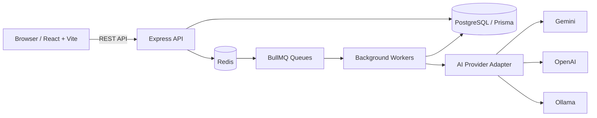

<div align="center">

# SupportPilot AI

### A Multi-Tenant Customer Support Platform Engineered for Correctness

A full-stack customer-support platform featuring tenant-scoped ticket workflows, role-based access control, idempotent requests, asynchronous processing, AI-assisted analysis, and API/database performance experiments.

**TypeScript · Node.js · Express · PostgreSQL · Prisma · Redis · BullMQ · React · Vite · k6**

</div>

---

## Overview

SupportPilot AI explores the engineering challenges behind building a reliable multi-tenant support platform—not just basic CRUD operations.

The system combines a TypeScript/Express API, React frontend, PostgreSQL persistence, Redis-backed job processing, AI-assisted ticket analysis, automated tests, and performance-analysis tooling.

Its engineering focus includes organization-level data isolation, concurrent ticket operations, idempotent request handling, asynchronous workflows, and database query analysis.

## At a Glance

| Area | Capabilities |
|---|---|
| Support workflows | Tickets, assignment, teams, comments, search, filters, pagination, analytics, notifications, audit history, and SLA workflows |
| Authentication and authorization | JWT authentication, refresh-token rotation, RBAC, organization and team scoping |
| Request correctness | Idempotency, payload-mismatch rejection, replay behaviour, and ticket-number uniqueness safeguards |
| Background processing | BullMQ workers for AI analysis, notifications, SLA processing, and cleanup |
| Testing | 102/102 backend unit tests and two integration suites recorded as passing 8/8 each in the latest project-session notes |
| Performance engineering | k6 workload scripts and PostgreSQL `EXPLAIN (ANALYZE, BUFFERS)` analysis |
| Operations | Health/readiness endpoints, Pino logging, request IDs, metrics endpoint, Docker Compose, and deployment configuration |

> **Measurement context:** Test counts and performance figures below are recorded local results, not production guarantees. Some archived artifacts are older than the latest recorded test runs.

## Key Engineering Highlights

- **Multi-tenant isolation:** Organization-scoped access to tickets, teams, comments, notifications, AI analysis, and analytics.
- **Concurrency correctness:** Tests for concurrent ticket creation, idempotency replay, assignment updates, and ticket lifecycle transitions.
- **Idempotent requests:** Duplicate requests can replay their original response; reusing an idempotency key with a different payload is rejected.
- **Asynchronous workflows:** Background jobs handle AI analysis, notifications, SLA processing, and cleanup.
- **Performance experiments:** k6 workloads exercise API endpoints, while PostgreSQL query plans provide visibility into database execution.
- **Operational visibility:** Structured logs, request correlation, health/readiness checks, and metrics instrumentation.

## Product Capabilities

### Customer Support

- Ticket lifecycle with validated state transitions.
- Team routing, assignment/reassignment, and assignment history.
- Public and internal comments.
- Search, status/priority filters, and paginated ticket listing.
- Audit trail, analytics, notifications, and SLA breach/escalation workflows.
- AI-assisted ticket analysis through a provider abstraction for Gemini, OpenAI, or Ollama.

### Identity and Security

- JWT-based authentication and refresh-token rotation.
- Role-based access control for admin, manager, and agent roles.
- Organization- and team-scoped authorization.
- Input validation, security headers, CORS configuration, and request-level rate limiting.
- Idempotency keys scoped by organization.

## Architecture



The diagram represents the logical application architecture, not independent proof of a live production deployment.

### Repository Structure

```text
src/
├── modules/             # Auth, tickets, teams, analytics, notifications, SLA, AI, audit
├── infrastructure/      # Prisma, Redis, queues, logging, metrics
├── shared/              # Middleware, validation, shared utilities
├── workers/             # AI, notification, SLA, cleanup processors
└── worker.ts             # Worker process entry point

frontend/                 # React + TypeScript + Vite
prisma/                   # Prisma schema and migrations
tests/                    # Unit and integration tests

performance/
├── k6/                   # Listing, creation, mixed-workload scripts
├── seed/                 # Performance-data generation
├── scripts/              # Benchmark helpers
├── sql/                  # Query-analysis SQL
└── results/              # Benchmark and query-plan artifacts

docs/
├── testing/              # Test design and evidence
├── performance/          # Baselines and query analysis
└── deployment/           # CI/CD and deployment notes

artifacts/                # Machine-readable test-result snapshots
```

Architecture notes: [`docs/architecture.md`](docs/architecture.md)

---

## Engineering Evidence

### 1. Multi-Tenant Isolation

**Recorded result: 8 passed · 0 failed · 0 blocked**

The integration suite uses the Express application, authentication flow, and a dedicated local PostgreSQL test database. It creates separate organizations and checks authorization through API behaviour and persisted data.

| Scenario | What is checked |
|---|---|
| Authentication | Protected routes reject unauthenticated requests |
| Ticket and AI reads | Cross-organization reads are denied without exposing private sentinel data |
| Mutations and comments | Foreign-ticket mutations, comments, and assignment attempts are denied; persisted data is checked after denied writes |
| Team/member scope | Team and member reads/mutations remain within the authenticated organization |
| Search and pagination | Search, filters, result rows, and totals remain tenant-scoped |
| Analytics | Aggregates use only the current organization's tickets |
| Notifications | Private notifications remain scoped to the authenticated user and organization |
| RBAC | Manager team scope is enforced and agents cannot escalate into privileged operations |

The archived run records approximately 11.4 seconds. Its environment metadata belongs to an earlier run.

- Test: [`tests/integration/tenant-isolation.test.ts`](tests/integration/tenant-isolation.test.ts)
- Test design: [`docs/testing/tenant-isolation.md`](docs/testing/tenant-isolation.md)
- Archived result: [`artifacts/tenant-isolation-results.json`](artifacts/tenant-isolation-results.json)

### 2. Concurrency and Ticket Lifecycle

**Latest project-session result: 8/8 integration cases passed**

The later project-session notes record a passing run of `tests/integration/concurrency-lifecycle.test.ts` after fixes to ticket DTO extraction and a Prisma query field. The archived JSON artifact is an older snapshot and does not represent that later passing run.

The eight scenarios cover:

1. Concurrent ticket creation preserves unique ticket numbers.
2. Concurrent duplicate requests replay the same idempotent response.
3. Reusing an idempotency key with a different payload returns `422`.
4. Valid ticket state transitions are accepted.
5. Invalid ticket state transitions are rejected.
6. Assignment updates preserve atomicity.
7. The same idempotency key is independent across organizations.
8. `PUBLIC` versus `INTERNAL` comment visibility is persisted correctly.

These tests cover the listed HTTP and database invariants. They do not prove global exactly-once execution across every possible failure mode.

- Integration test: [`tests/integration/concurrency-lifecycle.test.ts`](tests/integration/concurrency-lifecycle.test.ts)
- Related tests:
  - [`tests/idempotency.test.ts`](tests/idempotency.test.ts)
  - [`tests/regression.test.ts`](tests/regression.test.ts)
  - [`tests/ticket-state-machine.test.ts`](tests/ticket-state-machine.test.ts)
- Historical artifacts:
  - [`artifacts/ticket-lifecycle-concurrency.json`](artifacts/ticket-lifecycle-concurrency.json)
  - [`artifacts/idempotency-concurrency.json`](artifacts/idempotency-concurrency.json)

### 3. Automated Tests and Build Checks

The latest project-session record reports the following results.

| Check | Recorded result | Evidence context |
|---|---|---|
| Backend unit tests | 102/102 passed | Earlier archive documentation shows a previous 90-test snapshot |
| Tenant-isolation integration | 8/8 passed | Archived result JSON is available |
| Concurrency/lifecycle integration | 8/8 passed | Latest result recorded in project-session notes; archived JSON is stale |
| Backend typecheck/build | Passed | Recorded local result |
| Frontend typecheck/build | Passed | A bundle-size warning was observed |
| GitHub Actions | Not independently verified | Workflow existence does not establish a successful remote run |
| Render/Vercel deployment | Live smoke test not independently verified | Local builds do not prove end-to-end deployment correctness |

These are recorded results, not a claim that every check has been rerun on the current commit.

### 4. k6 Performance Experiments

The repository contains three workload scripts:

- [`performance/k6/ticket-listing.js`](performance/k6/ticket-listing.js) — authenticated, tenant-scoped listing.
- [`performance/k6/ticket-creation.js`](performance/k6/ticket-creation.js) — authenticated ticket writes.
- [`performance/k6/mixed-workload.js`](performance/k6/mixed-workload.js) — listing, detail reads, and ticket creation.

The following values are recorded local summaries. The supplied archive does not contain clean matching raw output for every successful run.

| Workload | Recorded profile | Requests | HTTP failures | p95 latency | p99 latency | Throughput |
|---|---|---:|---:|---:|---:|---:|
| Single-user baseline | 1 VU | Not retained | Not retained | Not retained | Not retained | Not retained |
| Ticket listing | 10 VUs; reported 30-second hold | 281 | 0% | 91.11 ms | 98.02 ms | Not captured |
| Ticket creation | Up to 5 VUs; roughly 2 minutes | 229, including login | 0% in the reported successful run | 86.96 ms | 154.14 ms | 1.81 req/s |
| Mixed workload | Concurrent read/write profile; script reaches up to 20 VUs | 4,311 | 164 (3.80%) | 75.52 ms | 113.1 ms | 12.6 req/s |

#### Interpreting the Results

- The listing and creation summaries reported no HTTP failures in those successful runs.
- The mixed workload recorded a **3.80% failure rate**. This was below the script's configured `<5%` error-rate threshold, but it was not a zero-error run.
- The exact HTTP status-code breakdown for the mixed workload was not retained, so the failures cannot be classified reliably from the summary alone.
- These latency figures are local observations, not production SLAs or capacity guarantees.
- The runs occurred before the later 10,000-ticket seed. Exact dataset sizes for each benchmark run were not recorded.
- An older [`performance/results/ticket-creation.json`](performance/results/ticket-creation.json) contains console text mixed with JSON-lines and describes a failed run against port `3000` with 18.88% HTTP failures. It is not the successful run shown above.

**Benchmark safety:** Run load tests only against a dedicated local performance database. The scripts use `API_BASE_URL`, `TEST_USERNAME`, and `TEST_PASSWORD`. Keep credentials out of source control and logs.

Result provenance: [`performance/results/README.md`](performance/results/README.md)

### 5. PostgreSQL Query-Plan Analysis

A local `EXPLAIN (ANALYZE, BUFFERS)` session was run against the dedicated `supportpilot_performance` database after seeding 10,000 tickets.

| Query pattern | Observed execution time | Plan observation |
|---|---:|---|
| Tenant listing + `OPEN` status | 0.112 ms | Used `tickets_organization_id_created_at_idx`; returned 20 rows |
| Tenant-scoped priority filter | 0.245 ms | Used the tenant/created-at index; filtered 658 rows |
| Substring search | 0.047 ms | `ILIKE` remained a filter for this query |
| Deep offset (`OFFSET 5000`) | 1.776 ms | Scanned 5,020 rows to return 20 |

Storage observed in the same local database:

| Storage metric | Observed size |
|---|---:|
| Ticket table | 3,728 kB |
| Indexes | 2,768 kB |
| Combined | 6,536 kB |

These are single-run local measurements on a warm cache, not p95/p99 latency. The deep-offset plan illustrates work that grows with the offset, but these measurements alone do not justify a schema change.

- Analysis notes: [`docs/performance/database-query-analysis.md`](docs/performance/database-query-analysis.md)
- Saved query-plan summary: [`performance/results/explain-analyze-2026-10-25-summary.md`](performance/results/explain-analyze-2026-10-25-summary.md)
- Performance baseline: [`docs/performance/baseline.md`](docs/performance/baseline.md)

### 6. Background Jobs and Failure Handling

BullMQ is used for asynchronous AI analysis, notifications, SLA processing, and cleanup. The codebase configures retries/backoff and retains failed jobs for inspection.

Unit-level retry/failure tests have passed. Live Redis/BullMQ integration scenarios for retry exhaustion, duplicate delivery, Redis interruption, and worker restart are not represented as verified here.

Failed-job retention is not the same as a dedicated dead-letter queue; this project does not claim to have a separate DLQ.

Background-job notes: [`docs/testing/background-jobs.md`](docs/testing/background-jobs.md)

---

## Technology Stack

| Layer | Technologies |
|---|---|
| Frontend | React, TypeScript, Vite, Tailwind CSS |
| API | Node.js, TypeScript, Express |
| Persistence | PostgreSQL, Prisma ORM |
| Queue and cache | Redis, BullMQ |
| Authentication/security | JWT, refresh-token rotation, RBAC, Helmet, request validation |
| Observability | Pino structured logging, request IDs, health/readiness, metrics endpoint |
| Testing/performance | Node.js test runner, HTTP integration tests, k6, PostgreSQL `EXPLAIN ANALYZE` |
| Local/deployment tooling | Docker Compose, GitHub Actions workflow, Render/Vercel configuration |

## Run Locally

### Prerequisites

- Node.js `>=22.12.0 <25`
- Docker Desktop with Docker Compose
- Git

### Setup

```bash
npm ci
cd frontend && npm ci && cd ..
cp .env.example .env

# Configure local-only environment values.
npm run prisma:generate
docker compose up -d
npm run prisma:migrate
```

Start the API in one terminal:

```bash
npm run dev
```

Start the worker in another terminal when testing asynchronous jobs:

```bash
npm run start:worker
```

Start the frontend in a third terminal:

```bash
cd frontend
npm run dev
```

### Verification Commands

From the repository root:

```bash
npm run typecheck
npm test
npm run build
```

For the frontend:

```bash
cd frontend
npm run typecheck
npm run build
```

For integration tests, use the dedicated test database and follow [`docs/testing/tenant-isolation.md`](docs/testing/tenant-isolation.md). Never point integration or load tests at production.

## Repository Documentation

- [Architecture](docs/architecture.md)
- [Tenant-isolation test design](docs/testing/tenant-isolation.md)
- [Concurrency/lifecycle integration tests](tests/integration/concurrency-lifecycle.test.ts)
- [Concurrency and idempotency report](docs/testing/concurrency-and-idempotency.md)
- [Background-job notes](docs/testing/background-jobs.md)
- [Performance baseline](docs/performance/baseline.md)
- [Database query analysis](docs/performance/database-query-analysis.md)
- [Benchmark artifact provenance](performance/results/README.md)
- [Deployment/CI configuration review](docs/deployment/ci-cd-verification.md)
