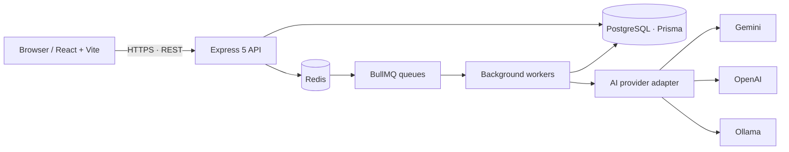

<div align="center">

# SupportPilot AI

### Multi-tenant customer support, built around correctness—not just CRUD.

A full-stack support platform with tenant-scoped ticket workflows, role-based access, idempotent request handling, background jobs, AI-assisted analysis, and measured API/database experiments.

**TypeScript · Node.js · Express · PostgreSQL · Prisma · Redis · BullMQ · React · Vite · k6**

</div>

---

## At a glance

| Area | What is implemented or tested |
|---|---|
| Product | Organizations, users and roles, teams, tickets, assignment, comments, search, filters, pagination, analytics, notifications, audit trail, SLA workflows and AI ticket analysis |
| Backend correctness | Real-HTTP integration tests for tenant isolation and ticket lifecycle/concurrency invariants |
| Security model | JWT authentication, refresh-token rotation, RBAC, organization/team scope, request validation, Helmet security headers and tenant-aware access |
| Request reliability | Redis-backed idempotency handling, payload-mismatch rejection, replay behaviour and ticket-number uniqueness safeguards |
| Async processing | BullMQ queues/workers for AI analysis, notifications, SLA processing and cleanup; retry/backoff configuration |
| Performance engineering | k6 single-user sanity testing, concurrent listing and ticket-creation workloads, mixed read/write workload, and PostgreSQL `EXPLAIN (ANALYZE, BUFFERS)` |
| Operations | Health/readiness endpoints, structured Pino logs, request IDs, metrics endpoint, Docker Compose and deployment configuration |
| Verification snapshot | Latest project-session record: 102/102 backend unit tests; tenant isolation 8/8; concurrency/lifecycle integration suite 8/8. See the evidence caveats below. |

> **Evidence standard:** figures below describe local development/test runs, not production capacity. Some successful k6 summaries were recorded in terminal output but their matching raw k6 JSON is not present in the supplied archive. The archived test JSON also contains an older snapshot for concurrency/lifecycle. This README calls out those provenance gaps rather than presenting stale files as current proof.

## Why this project is technically interesting

A support platform can look like ordinary CRUD until two organizations share a database, requests are retried, multiple users update the same ticket, or background work fails. SupportPilotAI focuses on those failure-prone boundaries:

- **Tenant boundaries:** organization A must not read or mutate organization B's tickets, comments, teams, notifications, AI analysis, or analytics.
- **Correctness under races:** ticket numbering, idempotency replay, assignment changes, and ticket state transitions need persisted-state assertions—not only successful HTTP status codes.
- **Asynchronous work:** API requests enqueue jobs while workers handle AI analysis, notifications, SLA checks and cleanup.
- **Measured performance:** benchmark scripts exercise existing API endpoints; PostgreSQL query plans are inspected against a dedicated seeded performance database.
- **Operational clarity:** health/readiness checks, structured logs, request correlation and explicit limitations make failures easier to diagnose.

## Product capabilities

### Customer-support workflows
- Ticket lifecycle with validated state transitions.
- Team routing, assignment/reassignment and assignment history.
- Public and internal comments.
- Search, status/priority filters and paginated tenant-scoped listing.
- Audit trail, analytics, notifications and SLA breach/escalation workflows.
- AI-assisted ticket analysis through a provider abstraction for Gemini, OpenAI or Ollama.

### Identity and security
- JWT-based authentication and refresh-token rotation.
- Role-based access control for admin, manager and agent roles.
- Organization and team scoped authorization.
- Input validation, security headers, CORS configuration and request-level rate limiting.
- Idempotency keys scoped by organization.

## Architecture



The diagram shows the logical application flow. Deployment configuration should be checked against the actual running services before treating the separate-worker topology as live deployment proof.

**Main code areas**

```text
src/
├── modules/             # Auth, tickets, teams, analytics, notifications, SLA, AI, audit
├── infrastructure/     # Prisma, Redis, queues, logging, metrics
├── shared/              # Middleware, validation and shared utilities
├── workers/             # AI, notification, SLA and cleanup processors
└── worker.ts            # Worker process entry point

frontend/                # React + TypeScript + Vite application
prisma/                  # Prisma schema and migrations
tests/                   # Unit and integration tests
performance/
├── k6/                  # Listing, creation and mixed-workload scripts
├── seed/                # Performance-data generation
├── scripts/             # Benchmark helpers
├── sql/                 # Query-analysis SQL
└── results/             # Benchmark/query result artifacts
docs/
├── testing/              # Test design and evidence
├── performance/          # Baselines and query analysis
└── deployment/           # CI/CD and deployment notes
artifacts/                # Machine-readable test result snapshots
```

See [architecture notes](docs/architecture.md).

## Engineering evidence

### 1. Multi-tenant isolation — 8/8 integration cases passed

The integration suite uses the real Express application, authentication path and a dedicated local PostgreSQL test database. It creates separate organizations and checks that authorization is enforced at the API and data layers.

| Scenario group | What is checked |
|---|---|
| Authentication | Protected routes reject unauthenticated requests |
| Ticket and AI reads | Cross-organization ticket/AI-analysis reads are denied without exposing private sentinel data |
| Mutations and comments | Foreign-ticket mutations, comments and assignment attempts are denied; persisted data is checked after denied writes |
| Team/member scope | Team and member reads/mutations stay inside the authenticated organization |
| Search and pagination | Search, filters, result rows and totals remain tenant-scoped |
| Analytics | Aggregates are calculated only from the current organization's tickets |
| Notifications | Private notifications remain scoped to the authenticated user and organization |
| RBAC | Manager team scope is enforced and agents cannot escalate into privileged operations |

**Recorded result:** 8 passed, 0 failed, 0 blocked; approximately 11.4 seconds in the archived run.

- [Tenant-isolation test design and reproduction](docs/testing/tenant-isolation.md)
- [Machine-readable archived result](artifacts/tenant-isolation-results.json)
- Test implementation: `tests/integration/tenant-isolation.test.ts`

The result artifact contains environment metadata from the earlier run. Re-run the suite and refresh the artifact before using it as evidence tied to a particular commit.

### 2. Concurrency and lifecycle — 8/8 integration cases passed in the later project session

The later local project session recorded **8/8 passing** for `tests/integration/concurrency-lifecycle.test.ts`, after fixes to the ticket DTO extraction and Prisma query field used by the test. The JSON artifact currently included in the archive is an older snapshot that reports earlier Windows worker-thread blocking; it has not been silently relabelled as the later run.

The eight integration scenarios cover:

1. Concurrent ticket creation preserves unique ticket numbers.
2. Concurrent duplicate requests replay the same idempotent response.
3. Reusing an idempotency key with a different payload returns `422`.
4. Valid ticket state transitions are accepted.
5. Invalid state transitions are rejected.
6. Assignment updates preserve atomicity.
7. The same idempotency key is independent across organizations.
8. Comment visibility (`PUBLIC` versus `INTERNAL`) is persisted correctly.

These tests exercise HTTP behaviour and database state. They demonstrate the invariants covered by these scenarios; they do **not** establish global exactly-once execution for every possible failure mode.

- Test implementation: `tests/integration/concurrency-lifecycle.test.ts`
- Related unit tests: `tests/idempotency.test.ts`, `tests/regression.test.ts`, `tests/ticket-state-machine.test.ts`
- Historical artifact to regenerate: `artifacts/ticket-lifecycle-concurrency.json`
- Historical idempotency artifact: `artifacts/idempotency-concurrency.json`

### 3. Automated tests and build checks

The latest project-session record reports:

| Check | Recorded result | Evidence note |
|---|---:|---|
| Backend unit tests | 102/102 passed | Older archive documentation/artifacts show a previous 90-test snapshot |
| Tenant isolation integration | 8/8 passed | Archived result JSON is available |
| Concurrency/lifecycle integration | 8/8 passed | Latest result was reported in the project session; archived JSON is stale |
| Backend typecheck/build | Passed | Re-run on the final commit |
| Frontend typecheck/build | Passed | A bundle-size warning was observed; consider code splitting if needed |
| Remote GitHub Actions run | Not independently verified in the supplied evidence | Workflow existence is not the same as a green remote run |
| Live Render/Vercel smoke test | Not independently verified in the supplied evidence | Do not infer live correctness from a local build |

### 4. k6 performance experiments

Three scripts exercise existing API endpoints:

- `performance/k6/ticket-listing.js` — authenticated, tenant-scoped listing.
- `performance/k6/ticket-creation.js` — authenticated ticket writes.
- `performance/k6/mixed-workload.js` — representative reads and writes (listing, detail and creation).

A single-user (1 VU) sanity/baseline run and concurrent-user runs were performed locally. The supplied archive does not retain a clean, matching raw output for every successful run, so the values below are the recorded summaries rather than a complete independently reproducible benchmark bundle.

| Workload | Load profile recorded | Requests | HTTP failures | p95 latency | p99 latency | Throughput |
|---|---|---:|---:|---:|---:|---:|
| Single-user sanity/baseline | 1 VU | Exact summary not retained in archive | Not retained | Not retained | Not retained | Not retained |
| Ticket listing | 10 VUs; reported 30-second hold | 281 | 0% | 91.11 ms | 98.02 ms | Not captured in saved summary |
| Ticket creation | Up to 5 VUs; roughly 2-minute run | 229, including login | 0% in the reported successful run | 86.96 ms | 154.14 ms | 1.81 req/s |
| Mixed workload | Concurrent read/write profile; up to 20 VUs in the script | 4,311 | 164 (3.80%) | 75.52 ms | 113.1 ms | 12.6 req/s |

**How to interpret these results**

- Listing and creation summaries reported no HTTP failures in those successful runs.
- The mixed run recorded a **3.80% failure rate**. It met the script's configured `<5%` error-rate threshold, but this is not a zero-error result. The exact status-code breakdown was not retained, so the failures still need classification (for example, rate limiting versus server errors).
- The measured latency values are local observations, not production SLAs or capacity guarantees.
- The runs happened before the later 10,000-ticket seed; exact row counts for each benchmark run were not recorded with the summaries.
- An older `performance/results/ticket-creation.json` file contains console text mixed with JSON-lines and describes a **failed run against port 3000** (18.88% HTTP failures). It is not the successful run shown above. See [result provenance notes](performance/results/README.md).
- Save clean raw output from fresh runs before making stronger claims. Include the commit SHA, dataset size, machine/runtime, duration, VU profile, thresholds, and exact API base URL.

**Reproduction safety:** use only a dedicated local performance database, never production or your primary development database. The scripts use `API_BASE_URL`, `TEST_USERNAME` and `TEST_PASSWORD` environment variables. Keep credentials out of source control and logs.

### 5. PostgreSQL query-plan analysis

A local `EXPLAIN (ANALYZE, BUFFERS)` session was run against the dedicated `supportpilot_performance` database after seeding 10,000 tickets.

| Query pattern | Observed execution time | What the plan showed |
|---|---:|---|
| Tenant listing + `OPEN` status | 0.112 ms | Used `tickets_organization_id_created_at_idx`; returned 20 rows |
| Tenant-scoped priority filter | 0.245 ms | Used the tenant/created-at index; filtered 658 rows |
| Substring search | 0.047 ms | `ILIKE` remained a filter for this query |
| Deep offset (`OFFSET 5000`) | 1.776 ms | Scanned 5,020 rows to return 20 |

Storage observed in the same local database: ticket table 3,728 kB; indexes 2,768 kB; combined 6,536 kB.

These are single-run local measurements on a warm cache, not p95/p99 latency. The deep-offset plan illustrates work that grows with the offset, but these measurements alone do not justify a schema change. Index/pagination changes should be backed by comparable before/after plans and workload measurements.

- [Database query analysis](docs/performance/database-query-analysis.md)
- [Saved query-plan summary](performance/results/explain-analyze-2026-10-25-summary.md)
- [Performance baseline and limitations](docs/performance/baseline.md)

### 6. Background jobs and failure handling

BullMQ is used for asynchronous AI analysis, notifications, SLA processing and cleanup. The codebase configures retries/backoff and retains failed jobs for inspection.

**Current evidence boundary:** unit-level retry/failure tests have passed, but live BullMQ/Redis integration scenarios for retry, exhaustion, duplicate delivery, Redis interruption and worker restart are still pending. A failed job retained in BullMQ is **not** the same as a dedicated dead-letter queue; this project does not claim to have a separate DLQ.

See [background-job notes](docs/testing/background-jobs.md) if present in the checkout. Confirm that the deployed API and a separately deployed worker match the intended topology before claiming end-to-end production job processing.

## Technology stack

| Layer | Technologies |
|---|---|
| Frontend | React, TypeScript, Vite, Tailwind CSS |
| API | Node.js, TypeScript, Express |
| Persistence | PostgreSQL, Prisma ORM |
| Queue/cache | Redis, BullMQ |
| Authentication/security | JWT, refresh-token rotation, RBAC, Helmet, request validation |
| Observability | Pino structured logging, request IDs, health/readiness and metrics endpoint |
| Testing/performance | Node.js test runner, HTTP integration tests, k6, PostgreSQL `EXPLAIN ANALYZE` |
| Local/deployment tooling | Docker Compose, GitHub Actions workflow, Render/Vercel configuration |

## Run locally

### Prerequisites

- Node.js version supported by `package.json` (currently `>=22.12.0 <25`)
- Docker Desktop with Docker Compose
- Git

### Setup

```bash
npm ci
cd frontend && npm ci && cd ..
cp .env.example .env
# Fill in local-only values. Never commit or share .env.
npm run prisma:generate
docker compose up -d
npm run prisma:migrate
```

Start the API in one terminal:

```bash
npm run dev
```

Start the worker in another terminal when testing asynchronous jobs:

```bash
npm run start:worker
```

Start the frontend in a third terminal:

```bash
cd frontend
npm run dev
```

### Verification commands

```bash
npm run typecheck
npm test
npm run build

cd frontend
npm run typecheck
npm run build
```

For integration tests, use the dedicated test database and follow the exact safety checks in [tenant-isolation.md](docs/testing/tenant-isolation.md). Do not point integration or load tests at production.

## Repository documentation

- [Architecture](docs/architecture.md)
- [Tenant isolation test design](docs/testing/tenant-isolation.md)
- [Concurrency/lifecycle integration tests](tests/integration/concurrency-lifecycle.test.ts)
- [Concurrency and idempotency report](docs/testing/concurrency-and-idempotency.md)
- [Background jobs](docs/testing/background-jobs.md)
- [Performance baseline](docs/performance/baseline.md)
- [Database query analysis](docs/performance/database-query-analysis.md)
- [Benchmark artifact provenance](performance/results/README.md)
- [Deployment/CI configuration review](docs/deployment/ci-cd-verification.md)
- [Portfolio-readiness audit](docs/portfolio-readiness-audit.md)

## Known limitations and next evidence to capture

This project is intentionally documented with boundaries rather than unsupported production claims:

1. **Refresh evidence:** rerun unit, tenant-isolation and concurrency/lifecycle suites on the final commit; regenerate stale JSON artifacts from the actual run.
2. **k6 raw outputs:** rerun 1-VU baseline, listing, creation and mixed workload; export clean raw/summary JSON, classify mixed-workload failures, and record dataset size and commit SHA.
3. **Queue integration:** add deterministic Redis/BullMQ integration tests for retry, exhaustion, duplicate delivery and worker recovery.
4. **CI/deployment:** verify a real successful GitHub Actions run and smoke-test the intended live frontend, API, database/Redis connectivity and separate worker.
5. **Repository hygiene:** exclude `.env`, `node_modules`, `dist`, local database dumps and secrets from public commits and recruiter ZIPs.
6. **Demo proof:** add genuine screenshots or a short workflow GIF and the verified live demo URL when available. Do not add placeholder URLs or pretend a deployment was smoke-tested.

## Security and sharing checklist

- Never commit `.env`, access tokens, API keys, JWT secrets, database credentials or production data.
- If a real secret was included in a shared archive, rotate it.
- Keep provider credentials on the server/worker side; never put secrets in `VITE_*` variables.
- Use synthetic fixtures and isolated databases for performance testing.
- Before sharing the repository, exclude `node_modules`, build output and local-only artifacts.
