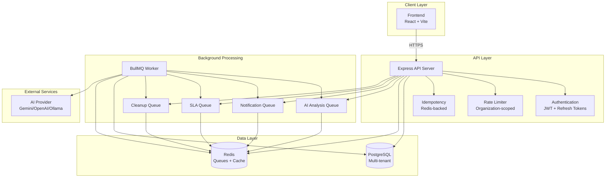
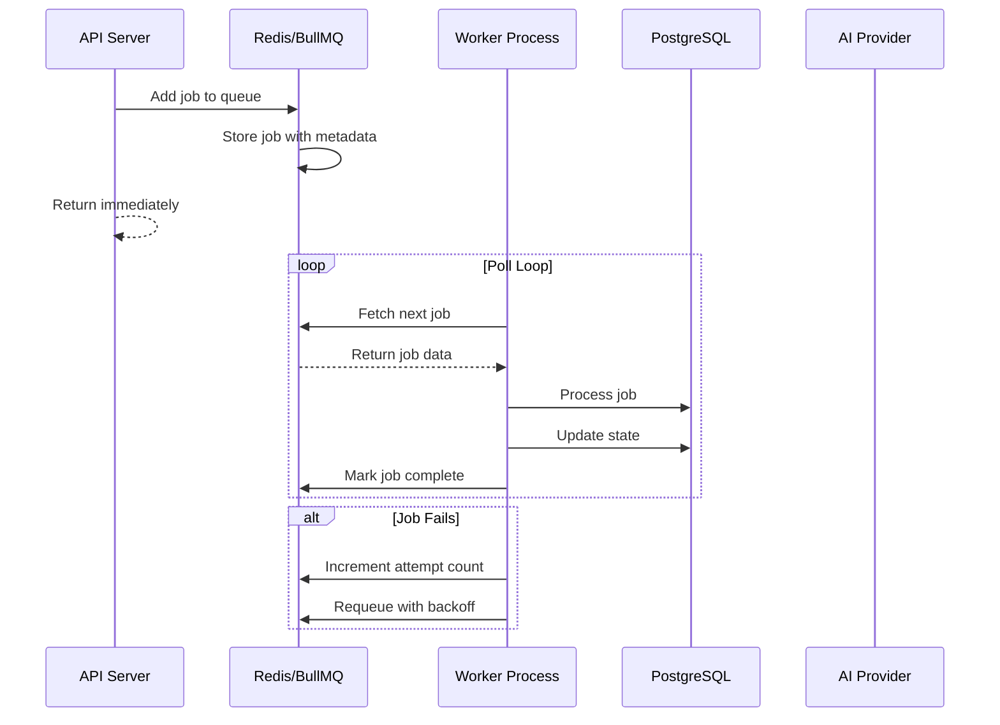
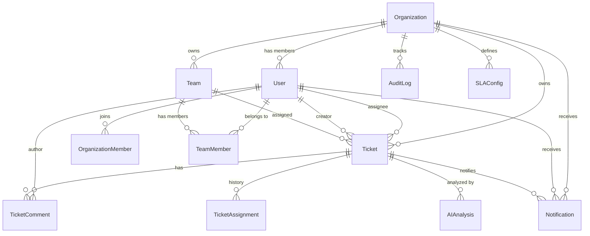
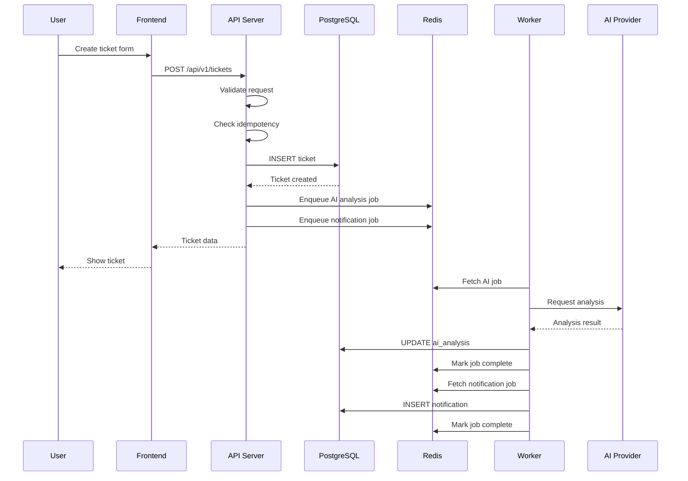
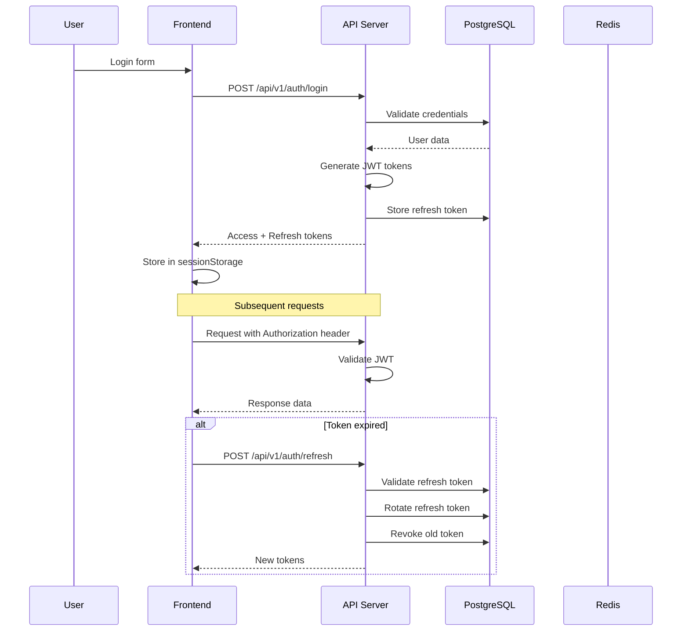

# SupportPilotAI Architecture

## System Overview

SupportPilotAI is a production-grade multi-tenant customer support platform built with Node.js, TypeScript, PostgreSQL, Redis, and BullMQ. The system is designed for scalability, reliability, and tenant isolation.

## High-Level Architecture



## Component Architecture

### Frontend (React + Vite)

**Technology Stack:**
- React 19
- TypeScript
- Vite 8
- Tailwind CSS 4
- React Router 7
- TanStack Query

**Key Features:**
- SPA with client-side routing
- Session management with automatic token refresh
- Real-time UI updates via polling
- Responsive design with Tailwind CSS
- Optimistic UI updates

**State Management:**
- Authentication state in React Context
- Server state with TanStack Query
- Local component state with React hooks

### Backend API (Express + TypeScript)

**Technology Stack:**
- Node.js 22+
- Express 5
- TypeScript 5
- Prisma ORM
- Pino logging
- Helmet security

**Middleware Stack:**
1. **Request ID:** Unique correlation ID per request
2. **Helmet:** Security headers (CSP, HSTS, etc.)
3. **CORS:** Origin validation with allowed list
4. **Rate Limiter:** Organization-scoped rate limiting
5. **Authentication:** JWT validation with refresh token rotation
6. **Idempotency:** Redis-backed deduplication
7. **Metrics:** Prometheus metrics collection

**API Routes:**
- `/api/v1/auth/*` - Authentication (public)
- `/api/v1/tickets/*` - Ticket management (protected)
- `/api/v1/teams/*` - Team management (protected)
- `/api/v1/notifications/*` - Notifications (protected)
- `/api/v1/analytics/*` - Analytics (protected)
- `/api/v1/examples/*` - Example routes (protected)

### Background Workers (BullMQ + Redis)

**Queue Architecture:**



**Queue Types:**

| Queue | Purpose | Retry Policy | Backoff |
|-------|---------|--------------|---------|
| `ai-analysis` | AI ticket analysis | 5 attempts | Exponential (2s) |
| `notification-dispatch` | Send notifications | 3 attempts | Exponential (1s) |
| `sla-processing` | SLA breach detection | 3 attempts | Fixed (5s) |
| `cleanup` | Data cleanup | 1 attempt | Fixed (60s) |

**Retry Strategy:**
- Transient errors: Automatic retry with backoff
- Permanent errors: Mark as failed, retain in queue (max 200)
- Dead-letter: No dedicated DLQ, failed jobs retained in original queue

### Database (PostgreSQL + Prisma)

**Schema Design:**

**Multi-Tenancy Strategy:**
- Shared database, shared schema
- Organization-scoped rows (every table has `organizationId`)
- Tenant isolation enforced at application layer

**Key Tables:**



**Indexing Strategy:**
- All tenant tables have `organizationId` as first index column
- Composite indexes for common query patterns (status + priority, assignee, team)
- Time-based indexes for recent-first queries (createdAt DESC)
- Soft-delete indexes (deletedAt)

**Query Patterns:**
- Tenant-scoped: Always filter by `organizationId`
- Pagination: LIMIT/OFFSET with index ordering
- Search: ILIKE with trigram indexes (optional enhancement)
- Analytics: Aggregated queries with GROUP BY

### Security

**Authentication:**
- JWT access tokens (15min expiry)
- Refresh token rotation (7d expiry)
- Token revocation on reuse detection
- Session expiry detection

**Authorization:**
- RBAC with roles: ADMIN, MANAGER, AGENT
- Organization membership validation
- Team-scoped access for managers
- Individual ticket access for agents

**Data Security:**
- Tenant isolation enforced at all layers
- SQL injection prevention via Prisma
- XSS prevention via Helmet CSP
- CSRF protection via same-site cookies
- Rate limiting per organization

**Infrastructure Security:**
- Database TLS required in production
- Redis TLS for rediss:// endpoints
- Secrets management (environment variables)
- IP allow lists for database/Redis

## Data Flow

### Ticket Creation Flow



### Authentication Flow



## Deployment Architecture

### Development

```
┌─────────────────────────────────────────┐
│         Docker Compose                  │
├─────────────────────────────────────────┤
│  ┌──────────┐  ┌──────────┐            │
│  │   API    │  │  Worker  │            │
│  │ :3000    │  │          │            │
│  └────┬─────┘  └────┬─────┘            │
│       │            │                   │
│  ┌────▼────────────▼────┐              │
│  │  PostgreSQL :5433   │              │
│  └─────────────────────┘              │
│  ┌─────────────────────┐              │
│  │  Redis :6379        │              │
│  └─────────────────────┘              │
└─────────────────────────────────────────┘
```

### Production (Render)

```
┌─────────────────────────────────────────┐
│         Render Cloud                    │
├─────────────────────────────────────────┤
│  ┌──────────┐  ┌──────────┐            │
│  │   API    │  │  Worker  │            │
│  │ :10000   │  │          │            │
│  └────┬─────┘  └────┬─────┘            │
│       │            │                   │
│  ┌────▼────────────▼────┐              │
│  │  Internal PostgreSQL│              │
│  │  (TLS required)     │              │
│  └─────────────────────┘              │
│  ┌─────────────────────┐              │
│  │  Internal Redis     │              │
│  │  (TLS optional)     │              │
│  └─────────────────────┘              │
└─────────────────────────────────────────┘
         ↓
┌─────────────────────────────────────────┐
│         Vercel (Frontend)               │
│  React SPA + Vite build                 │
└─────────────────────────────────────────┘
```

## Scalability Considerations

### Current Scale

**Single Instance Capacity:**
- ~100 req/s mixed workload
- ~10,000 tickets per organization
- ~100 concurrent users

### Scaling Strategy

**Vertical Scaling:**
- Upgrade to 4-8 CPU cores
- Increase memory to 8-16GB
- Optimize connection pool

**Horizontal Scaling:**
- Add API replicas (requires shared rate limit store)
- Add worker replicas (already designed for horizontal scaling)
- Use read replicas for analytics queries
- Load balancer with sticky sessions

**Database Scaling:**
- Connection pooling (PgBouncer)
- Read replicas for reporting
- Partitioning by organizationId (for very large tenants)
- Caching layer (Redis) for frequently accessed data

## Monitoring & Observability

### Metrics

**Application Metrics:**
- Request latency (p50, p95, p99)
- Request rate
- Error rate
- Queue depth
- Worker status

**Database Metrics:**
- Query latency
- Connection pool utilization
- Table/index sizes
- Lock contention

**Infrastructure Metrics:**
- CPU utilization
- Memory usage
- Disk I/O
- Network I/O

### Logging

**Structured Logging:**
- Pino logger with JSON output
- Request correlation IDs
- Error stack traces
- Performance timing

**Log Levels:**
- Error: Failed operations
- Warn: Degraded operations
- Info: Normal operations
- Debug: Detailed diagnostics

### Health Checks

**Endpoints:**
- `/health` - Basic health (always 200)
- `/ready` - Dependency health (PostgreSQL + Redis)
- `/metrics` - Prometheus metrics (with token)

## Reliability Features

### Idempotency
- Redis-backed request deduplication
- 24-hour TTL for idempotency keys
- Cross-tenant isolation
- Payload mismatch detection

### Retry Logic
- BullMQ automatic retries with backoff
- Transient error handling
- Dead-letter logging after max attempts
- Failed job retention (max 200 per queue)

### Data Integrity
- Database transactions for multi-step operations
- Audit logging for all mutations
- Soft deletes for data recovery
- Foreign key constraints

### Disaster Recovery
- Database backups (managed by provider)
- Redis persistence (AOF)
- Health check-based auto-restart
- Graceful shutdown handling

## Technology Rationale

### Node.js + TypeScript
- Async/await for non-blocking I/O
- Type safety with TypeScript
- Large ecosystem (npm)
- Fast development cycle

### Express
- Minimal, unopinionated
- Large middleware ecosystem
- Battle-tested
- Good performance

### PostgreSQL
- ACID compliance
- Complex queries
- JSON support
- Full-text search
- Reliable and scalable

### Prisma
- Type-safe database access
- Automatic migrations
- Good developer experience
- Multi-database support

### Redis
- Fast in-memory operations
- Pub/sub for real-time
- Rich data structures
- BullMQ integration

### BullMQ
- Reliable job queues
- Retry logic built-in
- Backoff strategies
- Job scheduling
- Good observability

### React
- Component-based architecture
- Large ecosystem
- Good performance with virtual DOM
- Server-side rendering support

### Vite
- Fast development server
- Optimized production builds
- ES module support
- Plugin ecosystem

## Security Architecture

### Defense in Depth

1. **Network Layer:** TLS, firewall rules
2. **Application Layer:** Authentication, authorization, rate limiting
3. **Data Layer:** Tenant isolation, encryption at rest
4. **Infrastructure:** Secrets management, access controls

### Threat Mitigation

| Threat | Mitigation |
|--------|------------|
| SQL Injection | Prisma parameterized queries |
| XSS | Helmet CSP, input validation |
| CSRF | Same-site cookies, CSRF tokens |
| Unauthorized Access | JWT auth, RBAC |
| Rate Limit Abuse | Per-organization limits |
| Data Leakage | Tenant isolation, encryption |
| Replay Attacks | Idempotency keys, nonces |

## Development Workflow

### Local Development
```bash
# Start infrastructure
docker-compose up -d

# Run migrations
npm run prisma:migrate

# Start API
npm run dev

# Start worker (separate terminal)
npm run start:worker

# Start frontend
cd frontend && npm run dev
```

### Testing
```bash
# Unit tests
npm test

# Integration tests
NODE_ENV=test TENANT_TEST_DATABASE_URL=... npm run test:integration

# Typecheck
npm run typecheck

# Build
npm run build
```

### Deployment
```bash
# Deploy to Render
git push render main

# Deploy frontend to Vercel
cd frontend && git push vercel main
```

## Future Enhancements

### Short Term
- Add search indexes (trigram GIN)
- Implement cursor pagination
- Add WebSocket support for real-time updates
- Improve error handling and user feedback

### Medium Term
- Add file upload support (attachments)
- Implement email notifications
- Add reporting dashboards
- Implement API versioning

### Long Term
- Multi-region deployment
- Event sourcing for audit trail
- Machine learning for auto-routing
- GraphQL API alternative
