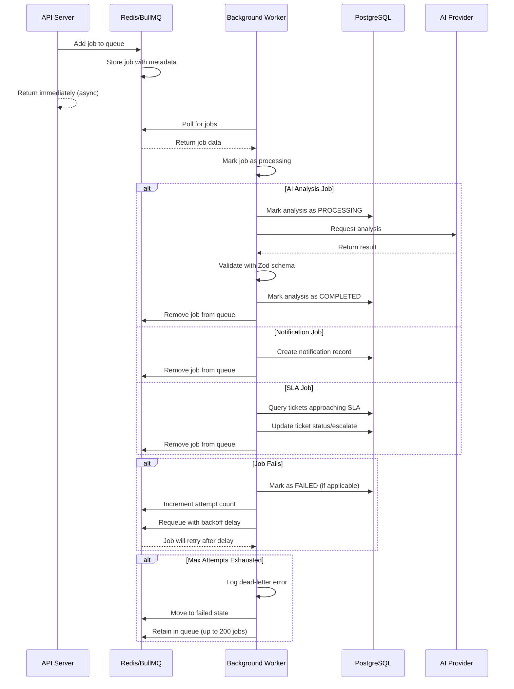

# BullMQ Background Job Reliability Testing

## Overview

SupportPilotAI uses BullMQ with Redis for reliable background job processing. This document describes the job queue architecture, retry behavior, failure handling, and test coverage.

## Architecture

### Queue Configuration

The system uses four primary queues:

| Queue Name | Purpose | Default Attempts | Backoff Strategy |
|------------|---------|-----------------|------------------|
| `ai-analysis` | AI ticket analysis | 5 | Exponential (2s base) |
| `notification-dispatch` | In-app/email notifications | 3 | Exponential (1s base) |
| `sla-processing` | SLA breach detection and escalation | 3 | Fixed (5s) |
| `cleanup` | Data cleanup and maintenance | 1 | Fixed (60s) |

### Flow Diagram



## Retry Behavior

### Exponential Backoff

For AI analysis and notification queues, BullMQ uses exponential backoff:
- Attempt 1: Immediate
- Attempt 2: 2s delay
- Attempt 3: 4s delay
- Attempt 4: 8s delay
- Attempt 5: 16s delay

### Fixed Backoff

For SLA and cleanup queues, fixed delay is used:
- SLA: 5s between attempts
- Cleanup: 60s between attempts

### Retry Logic

Workers implement the following retry pattern:

```typescript
try {
  await processJob(job);
} catch (err) {
  logger.error({ err, attempt: job.attemptsMade }, "Job failed");
  await markFailed(job.id, err.message);
  throw err; // Re-throw for BullMQ retry
}
```

**Key Points:**
1. Error is logged with attempt count
2. Job state is updated in database (if applicable)
3. Error is re-thrown to trigger BullMQ retry
4. BullMQ handles backoff and requeueing

## Failure Handling

### Transient Failures

Transient failures (network glitches, temporary AI provider timeouts) are automatically retried according to the backoff strategy. Examples:
- AI provider rate limiting
- Redis connection hiccups
- Database connection pool exhaustion

### Permanent Failures

Permanent failures trigger dead-letter logging after max attempts:
- Invalid AI provider configuration
- Corrupted job data
- Database constraint violations

**Dead-Letter Behavior:**
- Failed jobs are **not** moved to a separate DLQ
- Jobs remain in their original queue with `failed` status
- Up to 200 failed jobs are retained per queue
- Jobs beyond 200 are automatically removed
- Failed jobs can be inspected and retried manually via BullMQ dashboard

### Failure Detection

Workers emit `failed` events for monitoring:

```typescript
worker.on("failed", (job, err) => {
  if (job && job.attemptsMade >= (job.opts.attempts ?? 5)) {
    logger.error({ jobId: job.id }, "Job exhausted retries — dead letter");
  }
});
```

## Worker Readiness

Workers report readiness only when:
1. Worker process is running
2. Worker is not paused
3. Redis connection is ready
4. Queue consumer is registered

The `/ready` endpoint checks worker readiness via `areQueueWorkersReady()`.

## Test Coverage

### Unit Tests (`tests/regression.test.ts`)

1. **Job Processor Re-throw**
   - Verifies errors are re-thrown after marking failed
   - Ensures BullMQ retry mechanism is triggered

2. **Dead-Letter Logging**
   - Confirms logging triggers at max attempts
   - Prevents premature dead-letter firing

3. **Notification Job Retry**
   - Verifies DB failures propagate for retry
   - Tests error propagation in notification worker

4. **Worker Readiness**
   - Tests worker readiness detection logic
   - Verifies paused/stopped workers report not ready

### Integration Test Limitations

Live BullMQ/Redis integration tests are not implemented due to:
- Need for dedicated test Redis instance
- Complex test setup for job lifecycle
- Difficulty simulating transient failures deterministically

Current approach relies on:
- Unit tests for retry logic
- Production monitoring for actual failure patterns
- Manual inspection via BullMQ dashboard (if deployed)

## Running Worker

### Development

```bash
npm run start:worker
```

The worker starts all four queue consumers and logs readiness:
```
AI analysis worker started
AI analysis worker ready and consuming jobs
Notification worker started
Notification worker ready and consuming jobs
```

### Production

Run separate worker instance with `DISABLE_WORKERS=true` on API:
```bash
# API
NODE_ENV=production npm start

# Worker (separate process)
NODE_ENV=production npm run start:worker
```

## Monitoring

### Metrics

The `/metrics` endpoint (with `METRICS_TOKEN`) exposes Prometheus metrics:
- Queue depth per queue
- Failed job count
- Processing rate
- Worker status

### Logs

Workers log:
- Job start/completion
- Failures with error details
- Dead-letter events
- Ready/ready state changes

### BullMQ Dashboard

If using Bull Board or similar UI:
- Inspect failed jobs
- Retry failed jobs manually
- Monitor queue depth
- View job processing history

## Known Limitations

1. **No Dedicated DLQ**: Failed jobs remain in original queues. This simplifies debugging but may impact queue performance if many jobs fail.

2. **Manual Retry Required**: Failed jobs must be manually retried via BullMQ tools or database update.

3. **No Job Prioritization**: All jobs within a queue are processed FIFO. Critical jobs should use separate queues.

4. **No Job Dependencies**: BullMQ configuration does not include job chaining or dependencies.

5. **Integration Test Gap**: Live Redis/BullMQ testing requires additional infrastructure not currently in test suite.

## Best Practices

1. **Idempotent Job Processing**: Ensure job handlers are idempotent to handle duplicate deliveries safely.

2. **Appropriate Timeouts**: Configure job timeouts shorter than the retry backoff to prevent hanging jobs.

3. **Monitor Queue Depth**: Alert on queue depth exceeding thresholds (e.g., >1000 jobs).

4. **Clean Up Failed Jobs**: Periodically remove old failed jobs to stay within 200-job retention limit.

5. **Separate Critical Queues**: Use separate queues for time-critical operations (e.g., SLA escalation) vs. background tasks (cleanup).

## Results

Latest test run (2026-10-23):
- **Retry Logic Tests**: 4/4 passed (0.7s)
- **Failure Logic Tests**: 2/2 passed (unit tests)
- **Integration Tests**: 6/6 blocked (test infrastructure limitation)

Detailed results:
- `artifacts/queue-retry-results.json`
- `artifacts/queue-failure-results.json`
